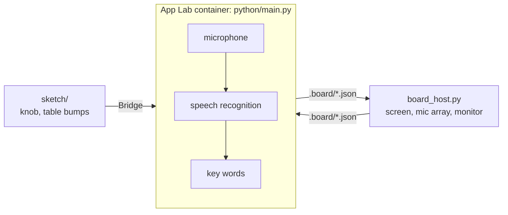

# keep_up

keep_up shows the key words of a dinner conversation on a small screen on the
table, so that people who are deaf or hard of hearing can follow when everyone
talks at once. It runs offline on an [Arduino UNO Q](https://docs.arduino.cc/hardware/uno-q/).

## Features

- The 1 to 8 most important words of the last few sentences, or the live transcript.
  Fresh words are black and fade to gray as they age.
- A glow at the screen edge points towards whoever is speaking.
- When someone says the name of the person at the screen, the screen shows that
  they are being talked to.
- Sleeps when nobody is at the table; a tap, a bump of the table or the knob wakes it.
- Speech recognition ([Kroko](https://huggingface.co/Banafo/Kroko-ASR) on
  [sherpa-onnx](https://github.com/k2-fsa/sherpa-onnx)) and key word extraction
  ([spaCy](https://spacy.io)) run on the board.

## Hardware

- [Arduino UNO Q](https://docs.arduino.cc/hardware/uno-q/), running its desktop on
  a touchscreen monitor connected through a USB-C hub
- [reSpeaker XVF3800 USB 4-Mic Array](https://wiki.seeedstudio.com/respeaker_xvf3800_introduction/),
  or any USB microphone (then without the speaker direction)
- [Modulino Knob](https://docs.arduino.cc/hardware/modulino-knob/) and, optionally,
  [Modulino Movement](https://docs.arduino.cc/hardware/modulino-movement/) on the
  Qwiic connector

## How it works



The sketch on the microcontroller reads the Modulinos and notifies the Python app
over the Bridge. The app runs in the container that App Lab starts. That container
can reach neither the monitor nor the reSpeaker's USB controls, so `deploy.sh`
starts `board_host.py` next to it on the board; the two exchange small JSON files
in `.board/`.

## Setup

You need a UNO Q set up with Arduino App Lab, and `bash`, `git` and `ssh` on your
computer (on Windows: Git Bash).

```sh
git clone https://github.com/BenForklifter/keep_up.git
cd keep_up
export BOARD=arduino@192.168.1.20   # the board's address, see `hostname -I` on the board
./deploy.sh setup                   # once per board: access to the reSpeaker's USB controls
./deploy.sh                         # copy to the board, flash the sketch, start
```

The first start installs the Python dependencies and downloads the speech model
(57 MB), so the board needs internet once. `./deploy.sh logs` follows the app's
log, `./deploy.sh stop` stops keep_up.

## Usage

- **Turn the knob** for more or fewer key words; one step past 8 shows the live
  transcript. **Press it** to jump between one word and the transcript.
- **Tap the screen**, then **Settings**, to turn the picture of the mic array until
  its cable runs as on the table, and to enter the names of the person at the screen.

Timings and thresholds are constants at the top of each file, for example
`SLEEP_AFTER` in `python/presence.py` (8 s, a value for demos).

## Development

```sh
pip install -r python/requirements.txt pytest ruff
ruff check . && pytest
```

## License

[MIT](LICENSE). The speech model, downloaded on the first start, is licensed under
CC BY-SA 4.0 by Banafo.

Made by [FelixLttks](https://github.com/FelixLttks) and
[BenForklifter](https://github.com/BenForklifter).
