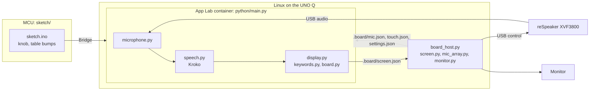

# keep_up

keep_up puts the key words of a dinner conversation on a small screen on the
table, so that people who are deaf or hard of hearing can follow along. It runs
entirely offline on an [Arduino UNO Q](https://docs.arduino.cc/hardware/uno-q/).

At a table where everyone talks at once, hearing aids and lip-reading reach their
limits, and whoever can't follow drops out of the conversation. This is known as
*Dinner Table Syndrome*. A glance at keep_up shows what the table is
talking about and what was just said.

## Features

- **Key words, not subtitles.** The screen shows the 1 to 8 most important words
  of the last few sentences: names, places, things and plans. Fresh words are
  black and fade to gray as they age. Words that keep coming up stay; when the
  conversation moves on, the old topic clears.
- **Live transcript.** The top step of the knob shows the running transcript
  instead.
- **Who is speaking.** With the reSpeaker XVF3800 mic array, a glow at the edge of
  the screen points towards whoever is speaking, and the array's LED ring lights
  up towards them in a color per seat.
- **Name call-out.** When someone says the name of the person at the screen, an
  orange frame says "Someone is talking to you". The recognizer listens for these
  names in particular.
- **Sleep mode.** When nobody has spoken, touched the screen, turned the knob or
  bumped the table for a while, the microphone, speech recognition and monitor
  turn off. A tap, a bump or the knob wakes keep_up up again.
- **Offline.** Speech recognition ([Kroko](https://huggingface.co/Banafo/Kroko-ASR)
  on [sherpa-onnx](https://github.com/k2-fsa/sherpa-onnx)) and key word extraction
  ([spaCy](https://spacy.io), [wordfreq](https://github.com/rspeer/wordfreq)) run
  on the board's CPU. Internet access is needed once, to install the dependencies
  and download the speech model.

## Hardware

| Part | Used for | |
|---|---|---|
| [Arduino UNO Q](https://docs.arduino.cc/hardware/uno-q/) | Runs everything | Required |
| Touchscreen monitor, connected through a USB-C hub with HDMI | Shows the words; settings | Required |
| [reSpeaker XVF3800 USB 4-Mic Array](https://wiki.seeedstudio.com/respeaker_xvf3800_introduction/) | Beamforming microphone, speaker direction, mute button | Recommended; any USB microphone works |
| [Modulino Knob](https://docs.arduino.cc/hardware/modulino-knob/) | Number of key words, live transcript | Recommended |
| [Modulino Movement](https://docs.arduino.cc/hardware/modulino-movement/) | Wakes keep_up when the table is bumped | Optional |

keep_up was developed with a 7" Elecrow touchscreen. The Modulinos connect to the
UNO Q's Qwiic connector; the monitor and the microphone go to the USB-C hub. The
UNO Q runs its desktop on the monitor, with the user `arduino` logged in.

## How it works



- The **sketch** on the UNO Q's microcontroller reads the Modulino Knob and
  Movement and notifies the Python app over the Arduino Bridge.
- The **Python app** runs in the container that Arduino App Lab starts. It reads
  the microphone, recognizes speech as it is spoken, and finds the key words in
  each line. A word's strength fades with a half-life and grows with every recent
  mention; the strongest words are shown, and each stays in its place long enough
  to be read (`board.py`).
- The container can reach neither the monitor nor the reSpeaker's USB controls,
  so **`board_host.py`** runs next to it on the board itself. It draws the screen
  with GTK, follows the speaker direction, and switches the monitor off while
  keep_up sleeps. The two exchange small JSON files in `.board/`.

## Setup

You need a UNO Q that is set up with Arduino App Lab and connected to your
network, and a computer with `bash`, `git` and `ssh` (on Windows, Git Bash).
Access to the board by ssh key saves typing the password on every deploy.

1. Clone the repository and tell `deploy.sh` where the board is. `hostname -I`
   on the board shows its address.

   ```sh
   git clone https://github.com/BenForklifter/keep_up.git
   cd keep_up
   export BOARD=arduino@192.168.1.20
   ```

2. Once per board, allow `board_host.py` to use the reSpeaker's USB controls.
   This installs a udev rule and asks for the board's sudo password.

   ```sh
   ./deploy.sh setup
   ```

3. Deploy and start keep_up:

   ```sh
   ./deploy.sh
   ```

   This copies the app to `~/ArduinoApps/keep_up` on the board, starts
   `board_host.py`, builds and flashes the sketch, and starts the app. On the
   first start App Lab installs the Python dependencies and keep_up downloads the
   speech model (57 MB), which takes a few minutes.

| Command | |
|---|---|
| `./deploy.sh logs` | Follow the app's log |
| `./deploy.sh board-logs` | Follow the log of `board_host.py` |
| `./deploy.sh stop` | Stop the app and `board_host.py` |

In VS Code, deploy, logs and stop are available as tasks (`.vscode/tasks.json`);
they take `BOARD` from the environment VS Code was started in.

## Usage

- **Turn the knob** for more or fewer key words (1, 2, 3, 4, 6 or 8); one step
  past 8 shows the live transcript. **Press it** to jump between the single most
  important word and the transcript. The current step is shown in the bottom-left
  corner.
- **Tap the screen** and then **Settings** to set up:
  - *Speaker direction*: turn and flip the picture of the mic array until its
    cable runs as it does on the table, seen from in front of the screen. Then
    the glow points at whoever is speaking.
  - *Name*: what the person at the screen is called, several names separated by
    commas, e.g. "Mary, Grandma".

  Settings are saved on the board and kept across deploys.
- The **mute button** on the reSpeaker mutes the microphone; the screen says so.
- The bottom-right corner shows the board's CPU load and RAM use.

## Configuration

The defaults are set as constants in the source:

| Setting | File | Default |
|---|---|---|
| `SLEEP_AFTER`: seconds without anyone before keep_up sleeps | `python/presence.py` | 8 (for demos; about 300 for everyday use) |
| `MONITOR_OFF`: monitor to standby while asleep, or just a dark screen | `python/board_host.py` | `True` |
| `LEVELS`, `START_LEVEL`: knob steps | `python/display.py` | 1, 2, 3, 4, 6, 8 words; starts at 3 |
| `THREADS`, `END_PAUSE`, `HOTWORD_SCORE`: speech recognition | `python/speech.py` | 2, 0.5 s, 1.5 |
| `BUMP_THRESHOLD_G`: table bump sensitivity | `sketch/sketch.ino` | 0.02 g |

## Evaluation

`tools/eval/eval.py` measures how well keep_up follows a conversation. It
synthesizes the scripted dinner conversations in `tools/eval/scenarios/` with
several voices, room reverb and restaurant noise, plays them into the running
app instead of the microphone, and scores the transcript (word error rate) and
the key words against the script.

```sh
python3 tools/eval/eval.py                  # all scenarios, restaurant noise at 10 dB
python3 tools/eval/eval.py 02_new_job --clean
```

It needs `ffmpeg` and `espeak-ng` (or [Piper](https://github.com/rhasspy/piper)
voices) on your computer; see the script's help for details.
[docs/speech-recognition.md](docs/speech-recognition.md) describes how the
speech recognizer was chosen with it.

## Development

```sh
pip install -r python/requirements.txt pytest ruff
ruff check .
pytest
```

The tests cover the logic that runs without the board's hardware: the key word
board, key word extraction, name matching and the evaluation's scoring.

## Project layout

```text
app.yaml              App Lab app definition
deploy.sh             deploy to the board, logs, stop, one-time setup
sketch/               MCU sketch: Modulino Knob and Movement
python/
  main.py             app entry point (runs in the App Lab container)
  microphone.py       reSpeaker XVF3800 or any USB microphone
  speech.py           streaming speech recognition (Kroko on sherpa-onnx)
  keywords.py         key word extraction (spaCy, wordfreq)
  board.py            which key words are shown, and where
  display.py          what the screen shows
  presence.py         sleep mode
  stats.py            CPU and RAM figures
  board_host.py       runs on the board itself: screen, mic array, monitor
  screen.py           fullscreen GTK display and settings
  mic_array.py        speaker direction and LED ring of the reSpeaker
  xvf3800.py          reSpeaker XVF3800 USB control protocol
  monitor.py          monitor standby through X11 DPMS
  shared.py           files shared by the app and board_host.py
tests/                unit tests
tools/eval/           end-to-end evaluation with synthetic conversations
docs/                 design notes
```

## Acknowledgements

- Speech model: [Kroko ASR](https://huggingface.co/Banafo/Kroko-ASR) community
  model by Banafo (CC BY-SA 4.0), as packaged for sherpa-onnx. It is downloaded
  on the first start, not distributed with this repository.
- The XVF3800 USB control protocol follows Seeed Studio's
  [reSpeaker XVF3800 host tools](https://github.com/respeaker/reSpeaker_XVF3800_USB_4MIC_ARRAY).
- The evaluation's background noise comes from the
  [DEMAND](https://zenodo.org/records/1227121) corpus (CC BY 4.0).

## License

[MIT](LICENSE). Third-party components, including the speech model, keep their
own licenses.

Made by [FelixLttks](https://github.com/FelixLttks) and
[BenForklifter](https://github.com/BenForklifter).
